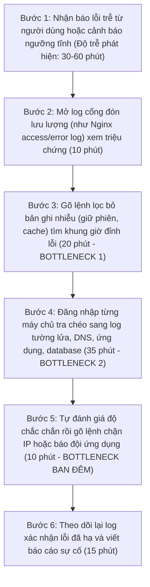
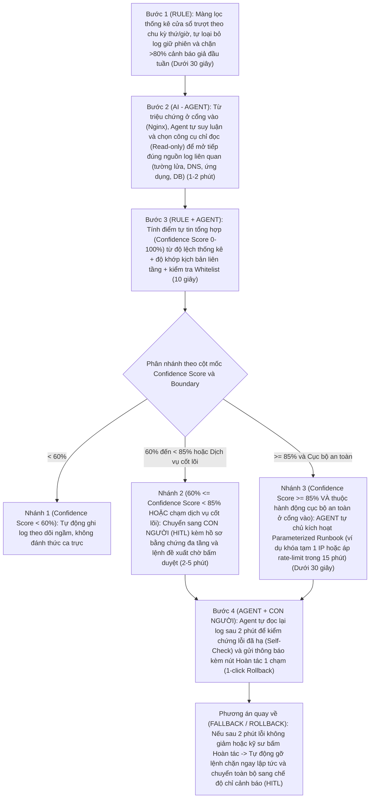

# Báo cáo nhóm — Day 02 Discovery & Problem Framing

> Bản chung của nhóm, viết trên repo do nhóm trưởng fork. Không copy file này sang repo cá nhân.
> Template chi tiết và prompt mẫu: [docs/01-worksheet.md](../../docs/01-worksheet.md). Bài mẫu: [docs/02-deliverable-example.md](../../docs/02-deliverable-example.md).

## 1. Thông tin nhóm

- Tên nhóm: HEHEHE
- Thành viên: xem `TEAM.md` (Bùi Đặng Nhật Nguyên, Đỗ Hoàng Vũ, Trần Gia Bảo, Trần Thị Hà Anh)
- Candidate problem được chọn (1 câu): Kỹ sư trực ca vận hành mất 90-120 phút mỗi sự cố để lần mò thủ công qua hàng chục nguồn log rời rạc và thiếu cơ chế AI tự chủ có kiểm soát (Agentic AI phân quyền theo cột mốc `Confidence Score` kết hợp `HITL`) để vừa cô lập tức thì bất thường rõ bằng chứng vào ban đêm vừa giữ lại ca nhạy cảm chờ con người duyệt.
- Quyết định cuối: **Go — pilot có điều kiện** tại tầng Nginx, bắt đầu bằng shadow/read-only và chỉ mở auto-containment cục bộ sau khi đạt các cổng an toàn.

---

## 2. Hội tụ nhóm (CP3)

### 2.1. Pitch

| # | Người đưa ra | Candidate (Job Story ngắn) | Actor | Bottleneck | Câu hỏi phản biện nhận được (ai hỏi) |
|---:|---|---|---|---|---|
| 1 | Bùi Đặng Nhật Nguyên | Khi hệ thống gặp lỗi hàng loạt hoặc bị khai thác bất thường (nhất là ban đêm), tôi muốn tự động lần ra nguyên nhân gốc giữa hàng chục nguồn log và phân quyền xử lý theo `Confidence Score` + `HITL`, để cô lập mối đe dọa rõ ràng trong vài phút mà vẫn an toàn cho ca nhạy cảm | Kỹ sư trực vận hành hệ thống (IT / NetOps On-call) | Bước 3, 4 & 5: Lọc nhiễu thủ công, tự mò mở tiếp hàng chục nguồn log trên nhiều máy chủ (55 phút) và chờ người thức dậy gõ lệnh chặn ban đêm | Con số 90-120 phút gồm thời gian phát hiện hay điều tra? Tính `Confidence Score` từ tín hiệu nào để LLM không tự chấm điểm cao ảo rồi chặn nhầm cổng hợp lệ? (Bảo, Vũ hỏi) |
| 2 | Bùi Đặng Nhật Nguyên | Khi trực ca vào giờ cao điểm sáng đầu tuần, tôi muốn phân biệt mức tăng lưu lượng tự nhiên theo chu kỳ với sự cố thật, để không kích hoạt nhầm quy trình phản ứng và không tốn thời gian đóng cảnh báo giả | Kỹ sư trực ca vận hành (On-call Engineer) | Bước 3 & 4: Tách lọc kết nối giữ phiên (WebSocket) và so sánh thủ công với số liệu sáng thứ Hai tuần trước (25 phút/đợt) | Dùng công thức thống kê cửa sổ trượt (`Rule`) đã đủ giải quyết hơn 80% cảnh báo giả chưa, có cần tới AI ở bước này không? (Bảo hỏi) |
| 3 | Bùi Đặng Nhật Nguyên | Khi gặp sự cố liên tầng phức tạp nằm dưới ngưỡng được phép tự động can thiệp, tôi muốn có sẵn hồ sơ bằng chứng xuyên qua các nguồn log kèm lệnh đề xuất, để người duyệt `HITL` và đội backend xử lý trong vài phút | Kỹ sư trực ca (người duyệt `HITL`) và Lập trình viên backend | Bước 2 & 4: Tra chéo qua nhiều nguồn log và biên soạn tóm tắt bằng chứng bàn giao (22 phút/sự cố) | Nếu gộp chung Card #2 (màng lọc đầu vào) và Card #3 (nhánh bàn giao `HITL`) vào làm các mắt xích bên trong Card #1 thì quy trình có trọn vẹn hơn không? (Vũ, Hà Anh hỏi) |
| 4 | Đỗ Hoàng Vũ | Khi nhận một lô vài trăm câu trắc nghiệm mới cần đưa vào ngân hàng đề, tôi muốn biết nhanh câu nào sai đáp án, có hai đáp án đúng hoặc lộ đáp án trong thân câu, để không phát hành câu hỏng tới học sinh | Người duyệt nội dung (giáo viên / content editor) ở trung tâm luyện thi hoặc edtech | Bước 2: Đọc và tự giải lại từng câu để kiểm đáp án (1,8-2,4 phút/câu, mất 4-6 giờ cho lô 150 câu) | Nếu dùng LLM tự giải lại để bắt lỗi đáp án trên các môn tự nhiên khó thì làm sao biết khi nào chính LLM giải sai? (Nguyên hỏi) |
| 5 | Đỗ Hoàng Vũ | Khi xem lại kết quả một bài thi trắc nghiệm trên Moodle, tôi muốn biết câu nào quá khó, quá dễ hoặc không phân loại được người học, để sửa ngân hàng đề trước kỳ thi sau | Giảng viên, giáo viên ra đề thi | Bước đọc và diễn giải bảng chỉ số thống kê câu hỏi sau kỳ thi (6/8 giảng viên bỏ qua không mở báo cáo) | Moodle đã tính sẵn các chỉ số thống kê câu hỏi, vậy vấn đề là thiếu công cụ hay giảng viên không có động lực sửa lại đề sau khi thi xong? (Bảo hỏi) |
| 6 | Đỗ Hoàng Vũ | Khi viết ba phương án nhiễu cho mỗi câu trắc nghiệm, tôi muốn biết phương án nào vô lý, trùng ý nhau hoặc quá giống đáp án đúng, để câu hỏi thực sự phân loại được người học | Người soạn câu hỏi trắc nghiệm (Content editor) | Bước tự nghĩ và đánh giá chất lượng 3 phương án nhiễu bằng cảm tính (3-5 phút/câu) | Tiêu chí định lượng thế nào là một phương án nhiễu tốt khi chưa có dữ liệu học sinh làm thử? (Hà Anh hỏi) |
| 7 | Trần Gia Bảo | Khi cần biết doanh thu, số đơn hoặc hiệu quả theo giai đoạn ngoài báo cáo cố định, tôi muốn tự hỏi và lấy dữ liệu từ hệ thống mà không phải chờ người biết viết SQL | Quản lý hoặc nhân viên nghiệp vụ không biết SQL | Bước 2-4: Gửi yêu cầu cho kỹ thuật, chờ làm rõ điều kiện lọc và viết câu lệnh SQL | Khách hàng doanh nghiệp đã có sẵn Dashboard BI (như PowerBI, Metabase) giải quyết phần lớn nhu cầu này chưa? (Vũ hỏi) |
| 8 | Trần Gia Bảo | Khi người dùng hỏi dữ liệu bằng câu thông thường, tôi muốn hệ thống hiểu đúng tên bảng, cột và quan hệ dữ liệu trong CSDL để không phải sửa truy vấn SQL nhiều lần | Lập trình viên triển khai Text-to-SQL, người sử dụng | Bước ánh xạ thuật ngữ nghiệp vụ của người dùng sang đúng cấu trúc bảng/cột (schema) khi JOIN nhiều bảng | Đây là bài toán kỹ thuật bên trong giải pháp Text-to-SQL hay là vấn đề gốc của người dùng cuối? (Nguyên hỏi) |
| 9 | Trần Gia Bảo | Khi một câu hỏi dữ liệu được diễn đạt theo nhiều cách khác nhau, tôi muốn nhận kết quả nhất quán và có thể kiểm tra nguồn bảng/điều kiện lọc, để tin tưởng số liệu dùng ra quyết định | Người dùng nghiệp vụ, người kiểm tra dữ liệu | Bước kiểm chứng xem câu truy vấn sinh ra có dùng đúng định nghĩa doanh thu/đơn hủy hay không | Nếu người dùng không biết đọc SQL thì họ kiểm tra tính đúng đắn của câu truy vấn bằng cách nào? (Hà Anh hỏi) |
| 10 | Trần Thị Hà Anh | Khi kết thúc mỗi buổi học Python (75 bài của 5 lớp), tôi muốn xác định nhanh lỗi sai lặp lại và viết nhận xét đúng với bài từng học sinh, để trả kết quả kịp thời mà không phải chấm tay từng bài từ đầu | Giáo viên dạy lập trình tại trung tâm (Minh) | Bước đọc từng bài code, tìm lỗi và gõ nhận xét riêng cho 75 bài dù nhiều lỗi lặp lại (ước tính 5-7 phút/bài) | Dùng bộ test tự động (Unit Test / Linter) đã bắt được phần lớn lỗi cú pháp và kết quả chạy code chưa? (Vũ, Nguyên hỏi) |
| 11 | Trần Thị Hà Anh | Khi chấm xong bài của một lớp, tôi muốn biết những lỗi nào xuất hiện nhiều nhất trong 15 học sinh, để điều chỉnh nội dung ôn tập cho buổi học tiếp theo | Giáo viên dạy lập trình | Bước tự thống kê và gom nhóm các lỗi sai phổ biến của 5 lớp sau mỗi buổi học | Nếu gắn nhãn mã lỗi lúc chấm bài thì chỉ cần bảng tổng hợp Excel (`No AI`) là thống kê được ngay đúng không? (Bảo hỏi) |
| 12 | Trần Thị Hà Anh | Khi kết thúc khóa học 12 tuần, tôi muốn tổng hợp điểm số, bài tập và sự tiến bộ của từng học sinh trong 75 em, để viết nhận xét cá nhân có căn cứ gửi phụ huynh | Giáo viên dạy lập trình, học sinh, phụ huynh | Bước mở lại ghi chú và bài làm suốt 12 tuần của 75 học sinh để viết nhận xét cuối khóa | Tần suất chỉ diễn ra 1 lần vào cuối khóa 12 tuần thì mức độ cấp thiết có cao bằng các việc lặp lại hàng ngày/hàng tuần không? (Nguyên hỏi) |

### 2.2. Cluster

| Cluster | Các candidate | Pattern chung |
|---|---|---|
| **A - Giám sát log đa tầng, điều tra nguyên nhân gốc & cô lập sự cố ngoài giờ (AIOps)** | #1, #2, #3 (Nhật Nguyên) | Dữ liệu đầu vào gồm hàng chục nguồn log phân tán và nhiều nhiễu; cần kết hợp lọc nhiễu chu kỳ (`Rule`), tự chủ chọn nhánh điều tra liên tầng (`Agent`) và phân quyền phản ứng theo ngưỡng điểm tự tin (`Confidence Score` + `HITL`) để xử lý kịp thời vào ban đêm |
| **B - Kiểm định nội dung câu hỏi trắc nghiệm & hỗ trợ chấm bài trong giáo dục (EdTech)** | #4, #5, #6 (Hoàng Vũ), #10, #11, #12 (Hà Anh) | Kiểm tra chất lượng đầu ra theo bộ quy tắc sư phạm và đáp án chuẩn lặp lại trên số lượng lớn câu hỏi/bài nộp; phần lớn giải quyết tốt bằng `Rule` (Linter, Unit Test, thống kê Moodle) kết hợp `Workflow` có người duyệt |
| **C - Truy xuất và đối chiếu dữ liệu kinh doanh từ cơ sở dữ liệu (Text-to-SQL)** | #7, #8, #9 (Gia Bảo) | Chuyển đổi yêu cầu ngôn ngữ tự nhiên thành câu lệnh truy vấn có cấu trúc; điểm nghẽn nằm ở việc chuẩn hóa định nghĩa chỉ số nghiệp vụ và kiểm chứng độ chính xác khi người dùng không biết đọc SQL |

### 2.3. Opportunity Solution Tree rút gọn

Gốc là **1 outcome**. Nhánh là **opportunity** (nhu cầu, pain), không phải tính năng hay công cụ.

```text
OUTCOME: Giảm thời gian từ lúc phát sinh bất thường đến lúc khoanh vùng đúng nguyên nhân gốc và cô lập sự cố từ 90-120 phút xuống dưới 5 phút (với ca đủ độ tin cậy tự động) và dưới 15 phút (với ca chờ người duyệt HITL), giữ tỷ lệ cảnh báo sai dưới 15% và 0 lần chặn nhầm kết nối hợp lệ.
│
├── Opportunity A (Đầu vào cảnh báo): Kỹ sư trực ca bị quá tải bởi cảnh báo giả vào giờ cao điểm đầu tuần (như sáng thứ Hai) do lưu lượng giữ phiên tăng tự nhiên, làm mất 30-40 phút kiểm tra tay và gây nguy cơ kích hoạt nhầm quy trình phản ứng.
│
├── Opportunity B (Điều tra liên tầng): Khi có triệu chứng lỗi ở cổng đón lưu lượng (như Nginx), kỹ sư mất 55 phút gõ lệnh lọc nhiễu và tự mò mẫm mở tiếp hàng chục nguồn log rời rạc (tường lửa, DNS, xác thực, ứng dụng, database) trên nhiều máy chủ để tìm nguyên nhân gốc.
│
└── Opportunity C (Phản ứng ca đêm & Bàn giao HITL): Vào ban đêm lúc vắng người trực màn hình, các đợt dò quét lỗ hổng hoặc gây nghẽn đã rõ bằng chứng không được cô lập kịp thời, trong khi các ca liên tầng nhạy cảm lại thiếu bản tổng hợp bằng chứng có dẫn nguồn để con người phê duyệt nhanh trong vài phút.
```

Những ý đã gạch bỏ vì là solution đội lốt opportunity:

- ~~"Xây dựng AI Agent tự động đọc toàn bộ log công ty và tự chạy lệnh shell sửa lỗi máy chủ"~~ (Gạch bỏ vì đây là giải pháp đóng gói sẵn, chưa tách rõ nỗi đau ở từng bước và cực kỳ nguy hiểm nếu cho sinh lệnh shell tự do không có ngưỡng kiểm soát).
- ~~"Tích hợp mô hình LLM local để tóm tắt file log Nginx"~~ (Gạch bỏ vì gọi tên công cụ cụ thể và thu hẹp sai bài toán: thực tế doanh nghiệp có hàng chục nguồn log đa tầng chứ không chỉ đọc 1-2 file log tĩnh).

### 2.4. Chấm điểm shortlist (1–5)

| Candidate | Actor rõ | Quy trình rõ | Pain có bằng chứng | Impact đo được | Vừa sức lab | So sánh được No AI/Rule/Workflow/Agent | Nhóm hiểu domain | Tổng |
|---|---:|---:|---:|---:|---:|---:|---:|---:|
| **1. Điều tra đa nguồn log & cô lập sự cố theo ngưỡng `Confidence Score` + `HITL` (Cluster A - #1, #2, #3)** | 5 | 5 | 4 | 5 | 4 | 5 | 5 | **33/35** |
| **2. Duyệt lô câu hỏi trắc nghiệm mới trước khi đưa vào ngân hàng đề (Cluster B - #4)** | 5 | 5 | 5 | 4 | 5 | 3 | 4 | **31/35** |
| **3. Tự lấy số liệu kinh doanh từ CSDL không phụ thuộc viết SQL (Cluster C - #7)** | 4 | 4 | 3 | 4 | 4 | 4 | 4 | **27/35** |
| **4. Chấm bài code Python và viết nhận xét cho 75 học sinh (Cluster B - #10)** | 4 | 4 | 3 | 4 | 4 | 3 | 4 | **26/35** |

**Candidate được chọn:** Điều tra sự cố qua hàng chục nguồn log rời rạc và tự động cô lập bất thường ngoài giờ theo kiến trúc **Agentic AI có kiểm soát (`Bounded Autonomy` phân quyền bằng cột mốc `Confidence Score` kết hợp `HITL` và `Rollback`)** (gộp hoàn chỉnh 3 mắt xích #1, #2, #3 của Cluster A).

**Vì sao chọn:**

- Có quy trình thực tế 6 bước rất rõ ràng từ trải nghiệm vận hành hạ tầng của thành viên trong nhóm, chỉ ra chính xác điểm nghẽn định lượng được (30-60 phút phát hiện trễ + 55 phút lọc nhiễu và tra chéo qua hàng chục nguồn log).
- Là bài toán thể hiện rõ nét và thuyết phục nhất sự khác biệt giữa cả 4 mức can thiệp (`No AI`, `Rule` ở bước lọc nhiễu chu kỳ, `Workflow` ở nhánh đóng gói hồ sơ `HITL`, và `Agent` ở bước tự chọn nguồn log điều tra liên tầng + tự chủ thực thi theo ngưỡng `Confidence Score`), giúp nhóm khai thác sâu bài toán quản trị rủi ro AI (`Boundary`, `Fallback`, `1-click Rollback`).

**Vì sao loại các candidate còn lại:**

- **Loại Candidate 2 (Duyệt câu hỏi trắc nghiệm - #4) và Candidate 4 (Chấm code Python - #10):** Dù có quy trình rõ, nhưng phần lớn lỗi hình thức/cú pháp giải quyết hiệu quả nhất bằng `Rule` (Regex, Unit Test, Linter) và một `Workflow` cố định chạy qua từng câu hỏi độc lập; không có nhu cầu rẽ nhánh điều tra động qua nhiều hệ thống hay ra quyết định tự chủ thời gian thực như bài toán vận hành hạ tầng, nên kém đất diễn hơn khi phân tích chiều sâu `Workflow vs Agent` ở CP6.
- **Loại Candidate 3 (Truy xuất số liệu kinh doanh Text-to-SQL - #7):** Các tình huống nhân viên kinh doanh chờ báo cáo hiện mới dừng ở giả thuyết từ góc nhìn kỹ thuật, chưa đo được baseline thời gian thực tế tại doanh nghiệp khách hàng và phần lớn nhu cầu tra cứu định kỳ có thể giải quyết bằng Dashboard BI sẵn có (`No AI`).

**Xử lý bất đồng (nếu có):**

- Ban đầu có ý kiến lo ngại đề tài giám sát đa nguồn log bằng Agentic AI quá rộng và rủi ro cao nếu máy tự chạy lệnh làm sập hệ thống thật. Nhóm đã giải quyết triệt để bằng cách: (1) Thiết kế cơ chế **Tự chủ có kiểm soát (`Bounded Autonomy`)** dựa trên 3 cột mốc `Confidence Score` kết hợp `HITL` và khóa chặt hành động trong `Parameterized Runbook` có nút `1-click Rollback`; (2) Thu hẹp phạm vi **Pilot 2 tuần đầu** chỉ áp dụng tại tầng cổng đón lưu lượng (Nginx) trước khi mở rộng sang các nguồn log dịch vụ khác.

---

## 3. Kiểm chứng + research giải pháp đã có (CP4)

### 3.1. Assumption Map

| # | Giả định | Loại (Value / Usability / Feasibility / Viability) | Quan trọng (1–5) | Đã có bằng chứng (1–5) | Kiểm chứng trước? |
|---:|---|---|---:|---:|---|
| 1 | Kỹ sư trực ca mất trên 60 phút để khoanh vùng được tầng gây lỗi khi sự cố trải qua nhiều nguồn log | Value | 5 | 2 | Có, ưu tiên |
| 2 | Kỹ sư chấp nhận để hệ thống tự chặn IP hoặc giới hạn tốc độ khi độ tin cậy cao | Value / Usability | 5 | 1 | Có, ưu tiên |
| 3 | Sự cố ngoài giờ, nhất là ban đêm, bị phát hiện và xử lý trễ hơn nhiều so với giờ hành chính | Value | 4 | 2 | Có |
| 4 | Cảnh báo giả chiếm phần đáng kể thời gian của ca trực | Value | 4 | 2 | Có |
| 5 | Doanh nghiệp đã có log tập trung để hệ thống đọc được, không phải đăng nhập từng máy | Feasibility | 4 | 3 | Có (hỏi kèm công cụ đang dùng) |
| 6 | Độ tin cậy có thể tính từ tín hiệu kỹ thuật (thống kê, bằng chứng liên tầng, whitelist) thay vì để mô hình tự chấm | Feasibility | 5 | 2 | Sau, cần thử nghiệm kỹ thuật |

Giả định nhóm kiểm chứng trong buổi này: #1, #2, #3, #4 (quan trọng nhưng ít bằng chứng), kèm #5 qua câu hỏi về công cụ đang dùng. Giả định #6 là câu hỏi kỹ thuật, không kiểm được bằng phỏng vấn, để lại cho pilot.

### 3.2. Kiểm chứng

Cách đã dùng: **Phỏng vấn 5 người** ngoài nhóm đã từng trực sự cố hệ thống: kỹ sư DevOps/SRE đang đi làm, quản trị hệ thống, lập trình viên backend. Hình thức: gặp trực tiếp, gọi video/điện thoại và nhắn tin. Câu hỏi theo The Mom Test, chỉ hỏi về lần sự cố gần nhất đã xảy ra. Bộ câu hỏi: [cp4-cauhoi-phongvan.md](../assets/cp4-cauhoi-phongvan.md).

Interview snapshot: [Tổng hợp 5 buổi phỏng vấn](../assets/cp4-interview-tonghop.md)

Tổng hợp:

| Nguồn | Số người / số mẫu | Tín hiệu xác nhận | Tín hiệu phản bác |
|---|---:|---|---|
| Phỏng vấn DevOps/SRE, quản trị hệ thống, dev backend | 5 | Đa số đều gặp các pain: lần mò qua nhiều nguồn log, sự cố ban đêm không ai phản ứng kịp, và cảnh báo giả. 2/5 người thường xuyên bị gọi dậy giữa đêm để xử lý sự cố. Bên cạnh Grafana/Loki/Prometheus hoặc Datadog/New Relic, vẫn có người phải ssh vào từng máy dùng grep/tail để đọc log | Thời gian khoanh vùng tầng lỗi phổ biến chỉ **15–30 phút**, thấp hơn nhiều so với giả định 60–90 phút. Đa số **không** chấp nhận cho hệ thống tự chặn vô điều kiện, chỉ đồng ý khi có whitelist, rollback và giới hạn thời gian chặn |
| Công cụ đang dùng | 5 | Đã có log tập trung và dashboard (Grafana/Loki/Prometheus, Datadog/New Relic) nên hệ thống có nguồn dữ liệu để đọc | Một phần việc khoanh vùng đã được công cụ có sẵn hỗ trợ, nên khoảng trống thật không nằm ở việc gom log |

**Nhóm đã sửa problem thế nào sau kiểm chứng:**

1. **Đổi baseline và trọng tâm bottleneck.** Khoanh vùng tầng lỗi trong giờ hành chính chỉ mất 15–30 phút, không phải 60–90 phút. Phần tốn thời gian thật là độ trễ phát hiện và phản ứng **ngoài giờ** cùng thời gian đóng cảnh báo giả. Problem Statement chuyển trọng tâm sang "sự cố ngoài giờ bị phản ứng trễ" thay vì "đọc log chậm" nói chung.
2. **Sửa success metric.** Baseline thời gian khoanh vùng ghi 15–30 phút theo phỏng vấn. Metric chính chuyển sang thời gian từ lúc bất thường xuất hiện đến lúc cô lập xong cho các sự cố ngoài giờ, kèm số cảnh báo giả mỗi ca.
3. **Siết boundary.** Hành động tự động chỉ được phép khi có đủ ba điều kiện người dùng yêu cầu: đối tượng không nằm trong whitelist, có rollback một chạm, và thời gian chặn có giới hạn. Mọi trường hợp khác chuyển sang người duyệt (HITL).

### 3.3. Research giải pháp đã có

| Công cụ / case / pattern | Link | Giải bước nào trong quy trình? | Điểm mạnh | Khoảng trống / rủi ro | Bài học cho nhóm |
|---|---|---|---|---|---|
| **Datadog Watchdog (Anomaly Detection & RCA)** | [Watchdog](https://docs.datadoghq.com/watchdog/) · [Watchdog RCA](https://docs.datadoghq.com/watchdog/rca/) | Bước 1, 3 và hỗ trợ bước 4: tạo baseline, phát hiện hành vi bất thường, gom log pattern và hỗ trợ điều tra nguyên nhân | Tự tạo baseline theo hành vi lịch sử; Watchdog RCA liên kết anomaly với APM, trace, hạ tầng và log pattern để hỗ trợ triage | RCA yêu cầu APM; Datadog khuyến nghị unified tagging. Tài liệu cũng chỉ nêu một số loại root cause được hỗ trợ, nên không thể coi đây là bằng chứng rằng công cụ sẽ tìm được mọi nguyên nhân hoặc tự khắc phục an toàn | Dùng baseline/Rule để giảm nhiễu trước; mọi kết luận root cause phải có telemetry truy xuất được và được kiểm trên dữ liệu của pilot |
| **Dynatrace Davis AI (Causal AI & Topology)** | [Davis AI](https://docs.dynatrace.com/docs/semantic-dictionary/model/davis) · [RCA concepts](https://docs.dynatrace.com/docs/dynatrace-intelligence/root-cause-analysis-classic/concepts) | Bước 4: đặt event trong topology, liên kết host/process/service và khoanh vùng root cause khả dĩ | Kết hợp quan hệ topology với event, transaction và dữ liệu liên quan thay vì chỉ dựa vào trùng thời gian | Kết quả phụ thuộc độ đầy đủ và đúng của telemetry/topology; đây là hỗ trợ phát hiện và RCA, không chứng minh rằng hệ thống nên được quyền tự chặn hoặc restart dịch vụ | Lớp điều tra cần topology và bằng chứng theo timestamp; policy cấp quyền thực thi phải tách khỏi mô hình suy luận |
| **PagerDuty AIOps + Event Orchestration** | [PagerDuty AIOps](https://support.pagerduty.com/main/docs/aiops) · [Event Orchestration](https://support.pagerduty.com/main/docs/event-orchestration) | Bước 1 và 5: giảm nhiễu/routing alert, áp rule theo event và gọi webhook hoặc Automation Action đã cấu hình | Có rule phân tuyến, suppress/pause alert, enrichment và khả năng kích hoạt automation trước khi báo người; quyền sửa orchestration được giới hạn theo role | Cần nguồn monitoring gửi event vào; không thay thế lớp thu thập/đọc log thô. Một số tính năng orchestration/automation thuộc gói nâng cao hoặc add-on; rule phức tạp có thể khó bảo trì | Chỉ gọi runbook định trước từ rule/policy; kiểm thử điều kiện, quyền, audit và rollback thay vì cho LLM sinh shell command |

---

## 4. Quy trình trước/sau (CP5)

### 4.1. Quy trình hiện tại

Sơ đồ quy trình xử lý sự cố hiện tại (6 bước thủ công, tổng thời gian từ lúc phát sinh bất thường đến lúc cô lập xong khoảng 90-120 phút, trong đó 30-60 phút là độ trễ phát hiện và khoảng 90 phút là thời gian kỹ sư thao tác):



| Bước | Actor | Input | Output | Thời gian / tần suất | Ghi chú |
|---:|---|---|---|---|---|
| 1 | Người dùng hệ thống / Kỹ sư trực ca (On-call) | Dịch vụ phản hồi chậm, báo lỗi hàng loạt hoặc cảnh báo ngưỡng tĩnh | Tin nhắn / ticket báo sự cố trong kênh vận hành | Độ trễ 30-60 phút sau khi lỗi bắt đầu tăng (trung bình 2-3 sự cố đáng kể/tuần) | Ban đêm không có người trực màn hình nên phát hiện rất muộn |
| 2 | Kỹ sư trực ca (IT / NetOps On-call) | Thông báo sự cố, quyền truy cập máy chủ cổng vào | Các dòng log triệu chứng ban đầu tại cổng proxy (như Nginx `access.log`, `error.log`) | 10 phút/lần | Mới chỉ thấy triệu chứng bề nổi (mã lỗi `5xx`/`4xx`), chưa biết nguyên nhân gốc |
| 3 | Kỹ sư trực ca | Hàng trăm nghìn dòng log thô ở cổng vào | Khung giờ đỉnh lỗi, danh sách đường dẫn hoặc IP nghi vấn sau khi tách bỏ kết nối giữ phiên | 20 phút/lần | **Bottleneck 1:** Tốn công gõ lệnh cắt lọc thủ công vì log chứa rất nhiều bản ghi giữ phiên (WebSocket) và kiểm tra sức khỏe định kỳ |
| 4 | Kỹ sư trực ca | Khung giờ đỉnh lỗi và dấu hiệu từ cổng vào | Nguyên nhân gốc được xác định (do dò quét lỗ hổng, lỗi DNS, treo dịch vụ backend hay database) | 35 phút/lần | **Bottleneck 2 (Nặng nhất):** Công ty có hàng chục nguồn log rời rạc ở nhiều tầng; kỹ sư phải tự suy đoán và đăng nhập từng máy chủ để đối chiếu mốc thời gian |
| 5 | Kỹ sư trực ca / Đội phát triển backend | Kết luận nguyên nhân gốc và mức độ rủi ro | Thực thi lệnh cô lập (như chặn IP, giới hạn tốc độ) hoặc bàn giao bằng chứng cho đội ứng dụng | 10 phút thao tác (nhưng vào ban đêm có thể trễ vài giờ vì chờ người thức dậy xử lý) | **Bottleneck 3 (Ban đêm):** Thiếu cơ chế tự động thực thi an toàn cho các ca đã rõ bằng chứng lúc vắng người trực |
| 6 | Kỹ sư trực ca | Trạng thái hệ thống sau khi can thiệp và lịch sử câu lệnh đã gõ | Xác nhận tỷ lệ lỗi đã về mức bình thường và bản tóm tắt sự cố | 15 phút/lần | Phải tự gom lại các đoạn log đã đọc từ nhiều cửa sổ terminal để viết báo cáo |

**Bottleneck chính:**

- **Điểm nghẽn điều tra (Bước 3 + Bước 4, mất 55 phút thao tác trực tiếp):** Kỹ sư phải lọc nhiễu bằng tay rồi tự mò mẫm mở tiếp hàng chục nguồn log khác nhau (tường lửa, DNS, xác thực, ứng dụng, database) trên nhiều máy chủ mà không có công cụ tự động chọn nhánh truy vết.
- **Điểm nghẽn phản ứng ngoài giờ (Bước 1 + Bước 5, mất thêm 40-70 phút):** Vào ban đêm, dù có những đợt dò quét lỗ hổng hoặc gửi truy vấn dồn dập rất rõ bằng chứng ở tầng cổng, hệ thống vẫn phải chờ con người thức dậy đọc log rồi mới gõ lệnh cô lập.

### 4.2. Quy trình tương lai

Ghi rõ bước nào **Rule**, bước nào **AI (`Agent`)**, bước nào **con người (`HITL`)**, **boundary** ở đâu, **phương án quay về** khi AI sai:



**Phân tách rõ vai trò và chốt chặn an toàn trong quy trình tương lai:**

- **Bước dùng `Rule` (Bước 1 + một phần Bước 3):** Lọc bỏ các bản ghi giữ phiên định kỳ (WebSocket/healthcheck), tính ngưỡng động theo khung giờ trong tuần để chặn cảnh báo giả sáng thứ Hai trước khi gọi Agent, và kiểm tra danh sách trắng (`Whitelist` IP nội bộ / cổng đối tác).
- **Bước dùng `AI - Agent` (Bước 2 + Bước 3 + Nhánh 3 + Bước 4):**
  - **Tự chủ điều tra (`Read-only`):** Tự quyết định cần gọi công cụ đọc nguồn log nào tiếp theo tùy theo mã lỗi ở cổng vào (không đi theo kịch bản cứng).
  - **Tự chủ thực thi có điều kiện (`Bounded Autonomy`):** Khi `Confidence Score >= 85%` và sự cố thuộc nhóm hành động cục bộ có thể đảo ngược ở tầng cổng (như khóa tạm thời 1 IP đang khai thác lỗ hổng trong 15 phút), Agent tự kích hoạt kịch bản chuẩn đã tham số hóa (`Parameterized Runbook`).
- **Bước `Con người trong vòng lặp (HITL)` (Nhánh 2 + Bước 4):** Khi `Confidence Score` nằm trong khoảng `60% đến < 85%` hoặc khi sự cố liên quan tới tầng ứng dụng/cơ sở dữ liệu dùng chung, kỹ sư trực ca nhận sẵn bảng tóm tắt bằng chứng có dẫn nguồn dòng log và chỉ cần bấm **Duyệt** hoặc **Bác bỏ** trên màn hình cảnh báo.
- **Ranh giới cấm (`Boundary`):**
  1. Agent chỉ có quyền **đọc (`Read-only`)** đối với toàn bộ các nguồn log; tuyệt đối **không được tự ý sinh lệnh shell tự do** (`rm`, `kill`, sửa file cấu hình gốc hay khởi động lại cụm database/ứng dụng lõi).
  2. Mọi thao tác ngăn chặn tự động chỉ được gọi qua hàm cố định (`Parameterized Runbook` như `rate_limit_ip(ip, ttl=15m)`), không bao giờ áp dụng lên dải IP nằm trong `Whitelist` hoặc dịch vụ thanh toán/dùng chung.
- **Phương án quay về (`Fallback & Rollback`):**
  1. **Tự động hết hạn (`Auto-TTL`):** Mọi lệnh cô lập tự động ở tầng cổng đều tự gỡ sau 15 phút nếu không được gia hạn.
  2. **Tự kiểm chứng (`Post-action Self-Check`):** Sau khi thực thi 2 phút, nếu tỷ lệ lỗi không giảm hoặc tăng thêm, hệ thống tự động rollback lệnh vừa chạy và đánh thức kỹ sư trực ca.
  3. **Nút Hoàn tác 1 chạm (`1-click Rollback`) & Công tắc ngắt (`Kill Switch`):** Kỹ sư có thể hủy lệnh chặn chỉ bằng 1 nút bấm trên tin nhắn thông báo; nếu mô hình AI gặp lỗi kết nối hoặc vượt ngưỡng cảnh báo sai, hệ thống tự động hạ cấp về `Rule + cảnh báo thủ công`.

### 4.3. Before / after

| Chỉ số | Trước | Sau (kỳ vọng) | Ghi chú |
|---|---:|---:|---|
| Số bước | 6 bước tuần tự | 4 bước tự động hóa + 1 bước duyệt/kiểm tra | Rút gọn toàn bộ khâu lọc nhiễu và tra chéo log thủ công |
| Tổng thời gian | 90-120 phút (gồm 30-60 phút phát hiện trễ + 60-70 phút điều tra và xử lý) | Dưới 5 phút (với ca `>= 85%` tự cô lập) hoặc dưới 15 phút (với ca `60% - < 85%` chờ người duyệt `HITL`) | Đo từ lúc xuất hiện chuỗi lỗi bất thường ở cổng vào đến lúc cô lập xong hoặc bàn giao đúng nguyên nhân gốc |
| Số bước thủ công | 6/6 bước (100% phụ thuộc kỹ sư đọc log và gõ lệnh) | 0 bước (ca đêm đủ ngưỡng tự tin `>= 85%`) hoặc 1 bước bấm duyệt `HITL` (ca nhạy cảm) | Giải phóng kỹ sư khỏi việc thức đêm đọc hàng trăm nghìn dòng log thô |
| Bottleneck chính | Bước 3 & 4 (55 phút lọc nhiễu và mò tìm qua hàng chục nguồn log) + Bước 5 (chờ người xử lý ban đêm) | Bước chờ kỹ sư xác nhận ở nhánh `HITL` (2-5 phút với hồ sơ bằng chứng đã gom sẵn) | Kỹ sư không phải tự đi tìm log nữa mà chỉ kiểm tra bằng chứng có dẫn nguồn |
| Rủi ro mới phát sinh | Không có rủi ro từ AI (nhưng chịu rủi ro gián đoạn dịch vụ kéo dài hàng giờ) | Nguy cơ điểm tự tin ảo dẫn tới chặn nhầm kết nối hợp lệ, hoặc log độc hại chứa câu lệnh lừa mô hình (Prompt Injection qua log) | Kiểm soát bằng công thức `Confidence Score` định lượng, `Whitelist`, khóa chặt trong `Parameterized Runbook` và nút `1-click Rollback` |

---

## 5. Problem Statement v0 (CP5)

> **Bản nháp để nhóm rà soát:** Phản ánh cách đặt vấn đề ban đầu ở CP3/CP5, **trước khi điều chỉnh theo kết quả phỏng vấn CP4**. Nhóm tự xác nhận câu chữ và nguồn số liệu trước khi nộp.

| Trường | Nội dung |
|---|---|
| **Actor** | Kỹ sư IT/NetOps hoặc DevOps/SRE trực ca chịu trách nhiệm theo dõi cổng vào web, phát hiện sự cố và phối hợp xử lý qua các tầng mạng, ứng dụng, cơ sở dữ liệu. |
| **Quy trình** | Khi nhận cảnh báo/ticket, kỹ sư (1) mở Nginx access/error log, (2) lọc WebSocket/cache và dòng log nhiễu, (3) đối chiếu firewall/DNS/backend/DB, (4) chọn biện pháp cô lập hoặc chuyển kỹ sư phụ trách, (5) kiểm tra lại tỷ lệ lỗi và ghi nhận kết quả. Đối chiếu chi tiết với sơ đồ 6 bước ở mục 4.1. |
| **Bottleneck** | **Giả định ban đầu:** Bước lọc nhiễu (20 phút) và tra chéo log nhiều tầng (35 phút) mất khoảng **55 phút thao tác**, trong khi khâu phát hiện và huy động người xử lý ngoài giờ làm chậm phản ứng. Các mốc này xuất phát từ mô tả quy trình ban đầu, chưa phải median đo trên tập sự cố. |
| **Impact** | Nhóm ban đầu đặt giả thuyết sự cố có thể mất **90–120 phút** từ khi bất thường xuất hiện đến lúc được cô lập; hệ quả là gián đoạn dịch vụ kéo dài, kỹ sư phải đọc nhiều nguồn log và người trực đêm bị gọi xử lý muộn. Không dùng 90–120 phút làm kết quả đã kiểm chứng. |
| **Success Metric** (baseline → target, cách đo) | **Baseline giả định v0:** 90–120 phút từ lúc phát sinh bất thường đến khi cô lập. **Target đề xuất:** <5 phút với ca được phép tự cô lập; <15 phút với ca cần HITL. **Cách đo:** đối chiếu timestamp đầu tiên của bất thường, cảnh báo, hoàn thành cô lập và hậu kiểm trên từng incident; tách riêng độ trễ phát hiện, thời gian điều tra, thời gian chờ duyệt. Các target chưa phải số liệu đạt được. |
| **Boundary** (AI không được làm gì; khi nào cần con người kiểm tra — HITL) | Không cấp quyền chạy shell tự do, không sửa/xóa log hay thay đổi production lõi; không chặn IP trong whitelist. Nếu chưa đủ bằng chứng hoặc tác động đến hệ thống dùng chung, phải chuyển kỹ sư trực ca duyệt. Chỉ cân nhắc các runbook được định nghĩa trước có khả năng hoàn tác. |

**Các điểm phản biện để nhóm tự đối chiếu và quyết định:**

- **Không đồng nhất các mốc thời gian:** 90–120 phút bao gồm phát hiện, điều tra và phản ứng; không được so trực tiếp với thời gian riêng để khoanh vùng log.
- **Kiểm chứng giả định “điều tra quá chậm”:** Kết quả CP4 cho thấy thời gian khoanh vùng được người được hỏi mô tả thường là **15–30 phút**. Như vậy việc chỉ tập trung tối ưu truy vấn log chưa phản ánh đúng pain lớn nhất.
- **Không mặc định tự chặn:** CP4 cũng ghi nhận đa số người được hỏi phản đối auto-block vô điều kiện, nên cần phân quyền, whitelist, TTL và rollback.

**Hướng sửa v1 được đề xuất từ bằng chứng CP4:** Thu hẹp sang **phát hiện/phản ứng ngoài giờ và kiểm soát cảnh báo giả**, thay vì nói mọi ca đều mất 90–120 phút để đọc log. Mức đồng thuận và câu chữ cuối phải được nhóm xác nhận.

---

## 6. Mức can thiệp AI (CP6)

### 6.1. Ma trận độ mơ hồ × độ phức tạp

Bài của nhóm nằm ở ô: **Độ mơ hồ Cao × Độ phức tạp Cao** (kết hợp một phần **Độ mơ hồ Thấp × Độ phức tạp Thấp** ở bước lọc nhiễu đầu vào).

Vì sao:

- **Độ mơ hồ cao ở triệu chứng đầu vào:** Cùng một biểu hiện tăng vọt mã lỗi `502`/`504` hoặc `400`/`404` tại tầng cổng đón lưu lượng (Nginx) có thể bắt nguồn từ rất nhiều kịch bản khác nhau: đợt tăng lưu lượng hợp lệ vào sáng đầu tuần, máy khách bị rớt mạng đồng loạt, kẻ tấn công dò quét lỗ hổng bảo mật, lỗi phân giải DNS nội bộ, hay một dịch vụ backend phía sau bị treo kết nối database. Không thể nhìn riêng một dòng log ở cổng vào mà biết ngay bản chất sự cố.
- **Độ phức tạp cao ở đường điều tra và quyết định phản ứng:** Hạ tầng thực tế có hàng chục nguồn log rời rạc ở nhiều tầng. Thứ tự cần mở tiếp nguồn log nào phụ thuộc hoàn toàn vào phát hiện ở bước trước đó (rẽ nhánh động nhiều vòng), sau đó còn phải tổng hợp độ tin cậy (`Confidence Score`) để quyết định tự cô lập ngay hay chuyển cho con người duyệt (`HITL`).

| Ma trận phân loại tác vụ trong bài toán của nhóm | Độ phức tạp Thấp (1-2 bước cố định) | Độ phức tạp Cao (Nhiều bước, rẽ nhánh động qua nhiều nguồn log) |
|---|---|---|
| **Độ mơ hồ Cao** (Triệu chứng đa nghĩa, cần suy luận ngữ cảnh liên tầng) | Tóm tắt và giải thích một đoạn log lỗi đơn lẻ -> *Phù hợp: LLM đơn lẻ* | **Bài toán chính của nhóm:** Tự chủ chọn nhánh điều tra qua hàng chục nguồn log và phân quyền cô lập sự cố theo `Confidence Score` + `HITL` -> ***Phù hợp: Agent có kiểm soát (Bounded Autonomy)*** |
| **Độ mơ hồ Thấp** (Quy tắc rõ ràng, định lượng được) | Lọc bỏ bản ghi giữ phiên (WebSocket/cache), tính ngưỡng cửa sổ trượt theo thứ/giờ, kiểm tra `Whitelist` -> ***Phù hợp: Rule (Bước 1)*** | Đóng gói hồ sơ sự cố theo mẫu cố định sau khi đã biết rõ nguồn lỗi -> *Phù hợp: Workflow tĩnh* |

### 6.2. So sánh 4 mức

| Mức | Phương án cho bài của nhóm | Đủ khi nào | Rủi ro | Chọn? |
|---|---|---|---|---|
| **No AI** (sửa quy trình) | Viết tài liệu hướng dẫn tra cứu (Runbook), gom log tập trung về một màn hình (OpenSearch/Loki) và chia lịch trực đêm | Khi hạ tầng nhỏ (chỉ có 1-2 máy chủ), ít sự cố ngoài giờ và luôn có kỹ sư thức trực nhìn màn hình 24/7 | Vào ban đêm vẫn mất 30-60 phút mới có người thức dậy đọc log; kỹ sư vẫn phải tự tra chéo thủ công qua hàng chục nguồn log khi sự cố phức tạp | Không (chỉ dùng làm nền tảng gom dữ liệu) |
| **Rule** | Đặt ngưỡng tĩnh hoặc công thức thống kê cửa sổ trượt trên tỷ lệ lỗi/lưu lượng; dùng biểu thức chính quy (`Regex`) tách log giữ phiên và chặn IP cố định khi vượt ngưỡng | Khi chỉ cần lọc nhiễu đầu vào hoặc chặn các mẫu tấn công đơn giản đã biết trước cấu trúc cố định | Nếu chỉ báo động thì ban đêm không ai xử lý kịp; nếu cho `Rule` tự động chặn thẳng khi vượt ngưỡng thì rất dễ khóa nhầm cổng đối tác hoặc người dùng thật lúc cao điểm | Chọn làm **Bước 1 (Màng lọc nhiễu đầu vào)** và kiểm tra `Whitelist`, nhưng không đủ cho toàn bộ bài toán |
| **Workflow** | Chuỗi bước cố định viết sẵn: Nhận cảnh báo -> Chạy cố định 3 câu truy vấn lấy log -> Đưa vào LLM tóm tắt -> Gửi tin nhắn báo kỹ sư trực ca | Khi công ty chỉ có 2-3 file log cố định (như chỉ có duy nhất log Nginx) và mục tiêu chỉ dừng ở việc gửi bản tóm tắt cho người đọc | **Không đủ cho thực tế đa nguồn log và phản ứng ban đêm:** Nếu viết cứng lệnh kéo toàn bộ hàng chục nguồn log mỗi lần có cảnh báo thì vừa quá tải chi phí token vừa chậm; nếu chỉ kéo cố định 1-2 nguồn thì bỏ sót nguyên nhân gốc ở tầng khác; đồng thời `Workflow` tĩnh chỉ biết gửi tin nhắn chứ không thể tự đánh giá độ tin cậy để cô lập sự cố ban đêm rồi tự kiểm tra lại sau 2 phút | Chọn làm **nhánh phụ (`HITL` đóng gói bằng chứng)**, không đủ làm kiến trúc chính |
| **Agent** | **Agent có kiểm soát (`Bounded Autonomy`):** Từ triệu chứng ở cổng vào, Agent tự chọn công cụ chỉ đọc để mở tiếp đúng nguồn log liên quan, tính `Confidence Score` tổng hợp, tự kích hoạt `Parameterized Runbook` nếu `>= 85%` (hoặc chuyển `HITL` nếu `60% - < 85%`), tự đọc lại log kiểm chứng sau 2 phút và cung cấp nút `1-click Rollback` | Khi có hàng chục nguồn log phân tán cần rẽ nhánh điều tra linh hoạt theo ngữ cảnh, đồng thời cần rút ngắn thời gian cô lập sự cố ban đêm xuống dưới 5 phút mà vẫn an toàn | Nguy cơ mô hình tự chấm điểm tự tin ảo, bị đánh lừa bởi nội dung log độc hại (Prompt Injection) hoặc gọi nhầm hành động nếu không khóa chặt quyền hạn | **CHỌN** (kết hợp `Rule` ở đầu vào, giới hạn trong `Parameterized Runbook`, phân tầng theo `Confidence Score` + `HITL`, và chạy Pilot từ tầng cổng Nginx trước) |

**Mức chọn:** Kiến trúc lai **Rule + Agentic AI có kiểm soát (`Bounded Autonomy` theo cột mốc `Confidence Score` kết hợp `HITL`)**.

**Vì sao không chọn mức đơn giản hơn (`Rule` hoặc `Workflow` tĩnh):**

1. **Lý do không dừng ở `Rule`:** `Rule` không hiểu được mối liên hệ ngữ nghĩa xuyên qua nhiều tầng hệ thống (ví dụ phân biệt giữa lỗi `502` do một cuộc tấn công dò quét lỗ hổng với lỗi `502` do dịch vụ backend đang khởi động lại hoặc đứt kết nối DNS). Nếu dùng `Rule` để tự động chặn IP vào ban đêm thì tỷ lệ chặn nhầm người dùng hợp lệ rất cao.
2. **Lý do `Workflow` tĩnh không đủ (luận điểm cốt lõi):**
   - Nếu bài toán chỉ có 2 file log tĩnh thì `Workflow` cố định là đủ. Nhưng trong hạ tầng doanh nghiệp thực tế có hàng chục nguồn log khác nhau (cổng proxy Nginx, tường lửa, DNS, dịch vụ xác thực, hàng loạt microservice và database), đường đi điều tra không cố định: mã lỗi `504` hướng Agent đi kiểm tra độ trễ upstream và database, trong khi chuỗi `400`/`404` bất thường hướng Agent đi kiểm tra log tường lửa và mẫu khai thác lỗ hổng. Một `Workflow` tuyến tính không thể tự chọn công cụ tra cứu theo từng giả thuyết.
   - Hơn nữa, bài toán đòi hỏi khả năng **tự chủ ra quyết định ngăn chặn vào ban đêm** kèm **vòng lặp tự kiểm chứng (`Self-Check`)** sau khi hành động. `Agent` mới có khả năng thực hiện vòng lặp *Quan sát triệu chứng -> Chọn nguồn log kiểm tra -> Chấm điểm `Confidence Score` -> Thực thi Runbook an toàn (nếu `>= 85%`) -> Đọc lại log sau 2 phút để xác nhận kết quả hoặc tự Rollback*.
   - Để kiểm soát rủi ro kỹ thuật và vừa sức thử nghiệm (Pilot), nhóm thu hẹp điểm khởi đầu ở tầng cổng đón lưu lượng (Nginx) trước khi mở rộng danh mục công cụ đọc log sang các tầng sâu hơn.

### 6.3. AI Canvas rút gọn

| Thành phần | Nội dung |
|---|---|
| **Prediction** - AI dự đoán / tạo ra gì? | 1. Dự đoán nhánh nguồn log cần mở tiếp theo để tìm nguyên nhân gốc.<br>2. Xác định nguyên nhân khả dĩ kèm trích dẫn dòng log gốc (timestamp, dịch vụ, mã lỗi).<br>3. Tính điểm tự tin tổng hợp (`Confidence Score` từ `0-100%`) và đề xuất hàm khắc phục tham số hóa (`Parameterized Runbook`) tương ứng. |
| **Judgment** - con người cân nhắc, quyết định gì? | 1. **Ở giai đoạn thiết kế:** Con người quy định công thức tính `Confidence Score`, thiết lập các cột mốc phân quyền (`60%`, `85%`), danh sách trắng (`Whitelist`) và danh mục hàm Runbook được phép gọi.<br>2. **Trong lúc vận hành:** Với các ca có `Confidence Score` từ `60% đến < 85%` hoặc chạm tới dịch vụ cốt lõi dùng chung, kỹ sư trực ca xem xét bộ bằng chứng đã gom sẵn để bấm **Duyệt** hoặc **Bác bỏ** (`HITL`), hoặc bấm **Hoàn tác 1 chạm (`Rollback`)** nếu phát hiện Agent chặn sai ở ca tự động. |
| **Action** - hành động cuối cùng là gì, ai làm? | - **Nếu `Confidence Score >= 85%` và thuộc phạm vi cục bộ an toàn ở cổng vào:** Agent tự động kích hoạt `Parameterized Runbook` (ví dụ áp giới hạn tốc độ hoặc cô lập tạm thời IP tấn công trong 15 phút), sau đó tự đọc log kiểm tra lại sau 2 phút.<br>- **Nếu `60% <= Confidence Score < 85%` hoặc đụng dịch vụ cốt lõi:** Kỹ sư trực ca bấm xác nhận thực thi hoặc chuyển tiếp hồ sơ bằng chứng cho đội backend sửa lỗi. |
| **Outcome** - đo kết quả bằng gì? | 1. Thời gian từ lúc phát sinh bất thường đến lúc cô lập xong hoặc khoanh vùng đúng nguyên nhân gốc (mục tiêu giảm từ `90-120 phút` xuống `< 5 phút` với ca tự động và `< 15 phút` với ca `HITL`).<br>2. Tỷ lệ cảnh báo sai dưới `15%`.<br>3. Số lần tự động chặn nhầm dải IP nội bộ / đối tác hợp lệ bằng `0`. |
| **Input** - AI cần dữ liệu đầu vào gì mỗi lần chạy? Có sẵn không? | 1. Luồng log thời gian thực từ cổng vào (như Nginx `access.log`, `error.log`) và quyền truy cập **chỉ đọc (`Read-only`)** tới log các dịch vụ liên quan (đã có sẵn trên máy chủ công ty).<br>2. Số liệu thống kê baseline theo khung giờ/thứ trong tuần (tự tổng hợp từ log lịch sử).<br>3. Danh sách trắng (`Whitelist` IP/dịch vụ) và bộ kịch bản chuẩn (`Parameterized Runbooks`). |
| **Feedback** - lấy phản hồi ở đâu để cải thiện? | 1. Kết quả tự kiểm tra log 2 phút sau khi thực thi (`Self-Check`: tỷ lệ lỗi `5xx`/`4xx` có giảm thật không).<br>2. Hành động bấm nút của kỹ sư trực ca (`Duyệt`, `Bác bỏ` ở nhánh `HITL`, hoặc bấm `1-click Rollback`).<br>3. Nhãn nguyên nhân gốc thực tế sau mỗi biên bản họp rút kinh nghiệm sự cố (Post-mortem) để hiệu chỉnh lại trọng số `Confidence Score`. |

### 6.4. Hai câu hỏi của Google PAIR

- **Người dùng muốn được hỗ trợ (`augment`) hay giao hẳn việc (`automate`)? Bằng chứng:**
  - Người vận hành cần **sự kết hợp phân tầng theo độ tin cậy và thời điểm (`Bounded Autonomy`)**, không chọn cực đoan một bên:
    1. **Giao việc có điều kiện (`Automate` kèm `Rollback`) khi `Confidence Score >= 85%`:** Vào ban đêm lúc không có người canh màn hình, đối với những đợt dò quét lỗ hổng hoặc gửi request làm nghẽn cổng vào đã rõ bằng chứng và có thể xử lý bằng hành động cục bộ đảo ngược được (như khóa tạm 1 IP ngoại lai trong 15 phút), kỹ sư muốn hệ thống **tự động cô lập ngay** để bảo vệ dịch vụ và không bị dựng dậy lúc nửa đêm.
    2. **Hỗ trợ ra quyết định (`Augment` qua `HITL`) khi `60% <= Confidence Score < 85%` hoặc đụng dịch vụ cốt lõi:** Với các sự cố liên tầng phức tạp hoặc chạm tới cơ sở dữ liệu/dịch vụ dùng chung, kỹ sư tuyệt đối không muốn máy tự ý khởi động lại hay sửa cấu hình, mà muốn Agent **đóng gói sẵn bằng chứng từ nhiều nguồn log kèm lệnh đề xuất** để con người kiểm tra và bấm duyệt trong vài phút.
- **AI sai kiểu nào tệ hơn, báo nhầm (`False Positive`) hay bỏ sót (`False Negative`)? Vì sao, và thiết kế đã xử lý thế nào:**
  - Mức độ nguy hại phụ thuộc vào **tầng hành động**, nên thiết kế tách làm 2 cơ chế xử lý riêng:
    1. **Ở tầng Tự động thực thi lệnh chặn (Auto-containment): Sai kiểu Báo nhầm / Chặn nhầm (`False Positive`) tệ hơn rất nhiều.** Nếu Agent tự động khóa nhầm IP cổng thanh toán đối tác hoặc chặn nhầm người dùng thật đang truy cập cao điểm, chính hệ thống AI sẽ gây ra sự cố gián đoạn diện rộng.
       - *Cách thiết kế xử lý:* Đặt ngưỡng tự thực thi rất cao (`Confidence Score >= 85%`), bắt buộc đối chiếu `Whitelist` bằng `Rule` cứng, cấm sinh lệnh shell tự do (chỉ gọi `Parameterized Runbook` có thời hạn tự mở `TTL 15 phút`), tự kiểm tra lại log sau 2 phút và trang bị nút **Hoàn tác 1 chạm (`1-click Rollback`)**.
    2. **Ở tầng Phát hiện và Gom bằng chứng cảnh báo (Detection & Triage): Sai kiểu Bỏ sót (`False Negative`) sự cố nghiêm trọng tệ hơn.** Nếu bỏ sót dấu hiệu dịch vụ bắt đầu treo dây chuyền vào ban đêm, sự cố sẽ kéo dài hàng giờ tới sáng hôm sau.
       - *Cách thiết kế xử lý:* Hạ ngưỡng thu thập bằng chứng xuống `60%`; mọi trường hợp nghi ngờ từ `60% đến < 85%` mà Agent chưa đủ tự tin tự xử lý đều không bị bỏ qua, mà được gom đầy đủ bằng chứng chuyển sang nhánh `HITL` cho kỹ sư trực ca quyết định.

---

## 7. Problem Statement v1 + tiêu chí đánh giá (CP6)

> **Bản nháp phục vụ nhóm review:** Căn cứ mục 3.2 (tổng hợp phỏng vấn 5 người), mục 4 (quy trình) và mục 6 (phương án Rule + Bounded Agent + HITL). Đây là **đề xuất để thành viên tự chỉnh và chốt**, không phải kết luận đã được pilot xác nhận. Các ngưỡng bên dưới là mục tiêu thử nghiệm.

| Trường | Nội dung |
|---|---|
| **Actor** | Kỹ sư DevOps/SRE/NetOps trực ca vận hành dịch vụ web có Nginx/WAF phía trước và nhiều nguồn log liên quan; **pilot** giới hạn ở loại sự cố có thể phản ứng cục bộ, hoàn tác được tại cổng vào. |
| **Quy trình** | **Hiện tại:** nhận alert/ticket → xem Nginx log → lọc nhiễu → tra chéo nguồn log → quyết định chặn/escalate → hậu kiểm. **Đề xuất:** Rule lọc cảnh báo nhiễu theo khung giờ → Agent chỉ đọc và chọn nguồn log tra tiếp → hệ thống tính Confidence Score từ tín hiệu kỹ thuật, đối chiếu whitelist → hoặc gọi runbook được phép ở tầng Nginx, hoặc chuyển hồ sơ có dẫn chứng tới kỹ sư duyệt HITL → self-check, rollback và audit. |
| **Bottleneck** | **Sau kiểm chứng:** Vấn đề trọng tâm là phản ứng chậm **ngoài giờ**, cảnh báo giả và thiếu cơ chế quyết định hành động an toàn khi không có người trực màn hình; việc tra chéo log vẫn khó nhưng không chứng minh được mọi ca mất 55 phút. Theo tổng hợp CP4, thời gian khoanh vùng tầng lỗi thường **15–30 phút**. |
| **Impact** | Phỏng vấn 5 người ngoài nhóm: **2/5** cho biết thường xuyên bị gọi dậy ban đêm; nhiều người phải chuyển giữa dashboard và truy vấn log thủ công. Chậm cảnh báo/escalate kéo dài thời gian ảnh hưởng dịch vụ; auto-block sai có thể gây gián đoạn cho người dùng hợp lệ. Chưa có baseline định lượng đáng tin cho toàn bộ thời gian từ lúc sự cố phát sinh đến cô lập ngoài giờ. |
| **Success Metric** (baseline → target, cách đo) | **Baseline xác nhận ở mức phỏng vấn:** khoanh vùng tầng lỗi thường **15–30 phút** (không phải toàn bộ thời gian cô lập). **Baseline phải bổ sung từ log/ticket:** median thời gian phát hiện → cô lập ngoài giờ; false-alert rate; số lần chặn nhầm. **Target pilot nhóm đề xuất:** ca đủ điều kiện tự cô lập **<5 phút**, ca cần HITL **<15 phút**, tỷ lệ cảnh báo sai **<15%**, **0 chặn nhầm** IP/dịch vụ hợp lệ. **Cách đo:** dùng timestamp sự kiện, alert, runbook, duyệt HITL, rollback và hậu kiểm; báo riêng theo loại ca và chỉ so cùng định nghĩa. |
| **Boundary** | Agent chỉ có quyền **read-only** khi thu thập log; không tự sinh và chạy shell command, không sửa DB, không restart dịch vụ lõi. Chỉ một tập **Parameterized Runbook** được quản trị trước tại Nginx/WAF mới có quyền thay đổi. Kiểm tra whitelist và quyền phải là điều kiện chặn cứng, không phụ thuộc LLM. Nhánh **60%–<85%** hoặc ảnh hưởng dịch vụ cốt lõi cần kỹ sư duyệt **HITL**. Nhánh **≥85%** chỉ được tự áp runbook cục bộ khi không chạm whitelist, có TTL tối đa 15 phút, tự kiểm tra sau 2 phút và rollback khi không cải thiện. Dưới **60%** chỉ theo dõi; sự kiện nguy cấp theo quy tắc an toàn vẫn phải được báo động, không được bỏ qua chỉ vì score thấp. |
| **AI intervention point** | Sau bộ lọc Rule và trước quyết định phản ứng: chọn nguồn log đọc tiếp theo ngữ cảnh, liên kết timestamp/sự kiện qua tầng, tổng hợp giả thuyết cùng ID log làm bằng chứng. Lớp Rule/policy riêng quyết định quyền thực thi; **LLM không tự chấm điểm tin cậy hay tự mở rộng quyền**. |
| **Mức chọn** | **Định hướng CP6 của nhóm:** kết hợp **Rule + Agent có giới hạn (Bounded Autonomy) + HITL**, thử trước ở Nginx. So sánh hiệu quả và an toàn với Workflow cố định trong pilot; chưa được coi là chứng minh Agent luôn tốt hơn Workflow. |
| **Rủi ro & người kiểm tra** | **Kết luận sai/bỏ sót tín hiệu:** DevOps/SRE đọc log ID, trace và hậu kiểm. **Confidence Score thiếu hiệu chuẩn, chặn nhầm:** người phụ trách vận hành/bảo mật kiểm thử ngưỡng, whitelist, quyền và runbook. **Prompt injection trong log / rò dữ liệu:** kỹ sư bảo mật và quản trị hệ thống kiểm RBAC, audit, giới hạn nguồn dữ liệu. **Rollback không hoạt động:** người trực ca có kill switch và theo dõi sau hành động. |

**Thay đổi so với v0 và lý do:**

| Trường | v0 | v1 | Vì sao đổi |
|---|---|---|---|
| **Actor / phạm vi** | Kỹ sư trực nhiều tầng, mọi loại sự cố | Tập trung hệ thống web và pilot hành động cục bộ tại Nginx/WAF | Giới hạn tác động, phù hợp phạm vi thử nhỏ và đánh giá rollback |
| **Pain chính** | Mất 90–120 phút/sự cố, thiên về tra log chậm | Phát hiện/phản ứng ngoài giờ, cảnh báo giả và quyết định chặn an toàn | CP4: khoanh vùng thường 15–30 phút, 2/5 người thường bị gọi dậy đêm |
| **Bottleneck** | Lọc log 20 phút + tra chéo 35 phút theo giả định workflow | Tách lọc nhiễu, phát hiện muộn ngoài giờ, phối hợp nhiều tín hiệu và phê duyệt | CP4 phản bác giả định khoanh vùng thường mất 60–90 phút |
| **Impact / baseline** | Dùng một khoảng 90–120 phút cho toàn bộ sự cố | Ghi 15–30 phút là thời gian khoanh vùng qua phỏng vấn; **chưa có baseline** ngoài giờ đến cô lập | Tránh so sánh hai loại thời gian đo khác nhau |
| **Success metric** | Tập trung giảm tổng thời gian | Thời gian cô lập theo auto/HITL, false-alert rate, không chặn nhầm; đo bằng timestamp từng sự cố | Tốc độ một mình không đủ nếu tăng cảnh báo sai hoặc chặn nhầm |
| **Boundary** | Không chạy shell tự do, có người duyệt trường hợp nhạy cảm | Cấm whitelist, ngưỡng 60%/85%, TTL 15 phút, self-check 2 phút, audit/rollback/kill switch | Người được phỏng vấn chỉ chấp nhận auto-block có điều kiện; thiết kế CP6 của nhóm |
| **AI intervention point** | Chưa chỉ rõ trách nhiệm AI | AI chỉ chọn hướng tra log/tổng hợp bằng chứng; policy độc lập kiểm quyền tự thực thi | Giảm rủi ro LLM tự đánh giá quá tự tin hoặc thực hiện sai lệnh |
| **Mức can thiệp** | Chưa chốt | Định hướng Rule + Agent giới hạn + HITL, còn cần pilot so với Workflow | Bám so sánh 4 mức CP6 nhưng chưa khẳng định đã kiểm chứng hiệu quả |

**Tiêu chí đánh giá đầu ra của AI (5 tiêu chí đề xuất):**

> Áp dụng cho tập incident đã ẩn danh và có nhãn hậu kiểm do kỹ sư xác nhận. Ngưỡng là **điều kiện đạt pilot đề xuất**, không phải kết quả kiểm thử thực tế.

| # | Tiêu chí | Đạt khi | Không đạt khi |
|---:|---|---|---|
| 1 | **Bằng chứng truy xuất được** | 100% nhận định kỹ thuật quan trọng có log ID/timestamp/nguồn kiểm tra lại được; thiếu chứng cứ phải nói rõ chưa xác định | Bịa log hoặc khẳng định root cause không dẫn được bằng chứng |
| 2 | **Khoanh vùng đúng, không bỏ sót** | Top-3 nguồn nghi vấn chứa nguồn được hậu kiểm xác nhận ở ≥80% ca; recall tín hiệu cốt lõi ≥90% trên tập có nhãn | Không đạt ngưỡng hoặc bỏ sót tín hiệu dẫn tới đề xuất xử lý nguy hiểm |
| 3 | **Lọc cảnh báo giả** | Tỷ lệ alert được hậu kiểm xác nhận là giả <15%, đồng thời không bỏ sót sự cố nghiêm trọng trong tập thử | False-alert rate ≥15% hoặc bỏ sót một sự cố nghiêm trọng |
| 4 | **Không vượt quyền, không chặn nhầm** | **0** truy cập vượt quyền, **0** lệnh ngoài runbook, **0** chặn nhầm IP/dịch vụ hợp lệ; mọi can thiệp có TTL, audit, rollback | Dù chỉ **1** vi phạm whitelist/quyền, chặn nhầm hoặc thiếu khả năng rollback |
| 5 | **Thời gian phản ứng có xác minh** | Ca đủ điều kiện tự cô lập <5 phút; ca HITL <15 phút từ khi bất thường xuất hiện; chỉ tính đạt nếu 4 tiêu chí an toàn/chất lượng phía trên đều đạt | Vượt mốc thời gian, không có timestamp, hoặc nhanh hơn nhưng sai/không an toàn |

**Cách đo:** Đánh dấu thời điểm đầu tiên xuất hiện bất thường, alert, nhận diện nguyên nhân khả dĩ, quyết định can thiệp, áp runbook, hậu kiểm và rollback. So sánh trên cùng tập ca có nhãn, tách **thời gian khoanh vùng** khỏi **thời gian phát hiện → cô lập**. Chỉ đánh giá điều kiện auto-containment trên sự cố có ground truth xác nhận đủ điều kiện; không “đẩy” ca khó sang auto để đạt tốc độ.

**Điểm cần nhóm tự xác nhận trước khi chốt:** Bộ 5 phỏng vấn mới có bản tổng hợp, không có timestamp từng sự cố; chưa có log pilot, chưa hiệu chuẩn công thức Confidence Score 40/40/20 hoặc ngưỡng 60/85. Các chỉ tiêu <5 phút, <15 phút, <15% là mục tiêu, **không phải kết quả đã đạt**. Thành viên có trách nhiệm tự kiểm tra và thống nhất câu chữ, vì `RULES.md` quy định AI chỉ được hỗ trợ phản biện Problem Statement.

---

## 8. Quyết định (CP6)

### 8.1. Bốn rủi ro

| Rủi ro | Câu hỏi | Mức độ rủi ro (Thấp = an toàn / TB / Cao = nguy hiểm) | Lý do / bằng chứng |
|---|---|---|---|
| **Value** | Người dùng có thật sự cần và sẽ dùng không? | **TB** | 5/5 người được hỏi từng phải tra nhiều nguồn log; 2/5 thường bị gọi dậy ban đêm và đa số chấp nhận auto-block có điều kiện. Tuy nhiên phỏng vấn phản bác baseline 60–90 phút: khoanh vùng thường chỉ 15–30 phút, chưa có log chứng minh thời gian phát hiện → cô lập ngoài giờ. |
| **Usability** | Người dùng có dùng được, có hiểu và sửa được đầu ra của AI không? | **TB** | Người dùng yêu cầu whitelist, giới hạn thời gian chặn và rollback. Thiết kế có evidence ID, HITL và kill switch, nhưng chưa thử giao diện duyệt/hoàn tác với kỹ sư trong một ca thật và chưa biết họ có hiểu `Confidence Score` hay không. |
| **Feasibility** | Có đủ dữ liệu, công cụ, kỹ năng để làm không? | **TB** | Nginx log, Rule lọc nhiễu và runbook cục bộ cho phép bắt đầu pilot read-only với phạm vi nhỏ. Tuy nhiên chưa có tập incident gán nhãn, telemetry liên tầng hay score đã hiệu chuẩn; vì vậy mốc 60/85 và target <5/<15 phút là cổng cần kiểm chứng trước khi mở quyền tự động. |
| **Viability** | Có hợp chi phí, pháp lý, quy định tổ chức không? Ai vận hành? | **TB** | Pilot giới hạn ở dữ liệu nội bộ và chưa cho phép thay đổi production trong giai đoạn shadow nên tác động ban đầu thấp. Trước giai đoạn auto-containment, nhóm phải chỉ định owner cho whitelist/runbook, RBAC, audit, kill switch và trách nhiệm rà soát sau sự cố. |

### 8.2. Kết luận

**Quyết định:** **Go — pilot có điều kiện** tại tầng Nginx.

**Lý do:** Đa số người được hỏi từng phải tra nhiều nguồn log, 2/5 thường bị gọi dậy ban đêm và đa số chấp nhận auto-block khi có whitelist, TTL và rollback. Bằng chứng này đủ để đầu tư vào một pilot nhỏ, có thể đảo ngược. Tuy nhiên chưa đủ để triển khai auto-containment rộng trong production, nên quyết định Go đi kèm phạm vi Nginx, triển khai theo hai giai đoạn, HITL và các cổng an toàn bắt buộc.

**Nếu Go — pilot nhỏ nhất:** **Giai đoạn 1 — Shadow/read-only:** chạy 2 tuần trên tối thiểu 30 incident/alert lịch sử hoặc phát sinh mới; Agent chỉ đề xuất nguồn log, nguyên nhân, evidence ID và runbook, còn kỹ sư duyệt và thực hiện. **Giai đoạn 2 — Auto-containment giới hạn:** chỉ mở khi giai đoạn 1 đạt 100% kết luận quan trọng có bằng chứng, Top-3 root-cause hit rate ≥80%, false-alert rate <15%, không bỏ sót sự cố nghiêm trọng và 0 vi phạm quyền/whitelist. Quyền tự động chỉ gồm rate-limit hoặc chặn tạm IP ngoài whitelist bằng runbook định trước, TTL tối đa 15 phút, self-check sau 2 phút và rollback/kill switch.

**Nếu Not Yet — cần kiểm chứng gì trước:** Không áp dụng cho quyết định hiện tại; các nội dung cần kiểm chứng được chuyển thành cổng bắt buộc giữa hai giai đoạn của pilot Go.

**Nếu No-Go — nên làm gì thay AI:** Không áp dụng cho quyết định hiện tại; nếu pilot chạm ngưỡng dừng thì quay về Rule cho baseline/lọc nhiễu và Workflow read-only để gom bằng chứng cho người trực.

**Ngưỡng dừng:** Dừng pilot ngay nếu có **1** lần truy cập vượt quyền, đề xuất chặn đối tượng trong whitelist, thực thi ngoài runbook, rollback/kill switch thất bại hoặc bỏ sót một sự cố mức nghiêm trọng. Sau 2 tuần/30 mẫu, nếu Top-3 hit rate <80%, false-alert rate ≥15% hoặc median ca HITL không dưới 15 phút thì không mở quyền tự động; quay về **Rule + Workflow read-only + HITL**, sửa dữ liệu/rule rồi đánh giá lại.

---

## 9. Hạn chế và hướng tiếp theo

**Hạn chế:**

- Giả định #6 (Confidence Score tính từ tín hiệu kỹ thuật phân biệt được sự cố thật với lưu lượng tăng tự nhiên) chưa được kiểm chứng; đây là rủi ro kỹ thuật lớn nhất.
- Chưa có dữ liệu log thật để đo tỷ lệ báo sai và tỷ lệ chặn nhầm của phương án đề xuất.
- Kết quả hiện dựa trên 5 phỏng vấn tổng hợp, chưa có timestamp từng sự cố và chưa có log pilot; các target là ngưỡng đề xuất, không phải kết quả đã đạt.
- Cần thống nhất owner cho dữ liệu, whitelist, runbook, audit và trực kill switch trước khi thử bất kỳ hành động thay đổi hệ thống nào.

**Hướng tiếp theo:**

- Thu log lịch sử tầng Nginx của một dịch vụ không cốt lõi, gán nhãn các sự cố đã biết, rồi chạy thử công thức Confidence Score offline trước khi cho hệ thống hành động.
- Phỏng vấn thêm người trực ca, ghi biên bản riêng từng buổi, tập trung vào sự cố ngoài giờ và cảnh báo giả.
- Chạy pilot ở chế độ chỉ đề xuất (người duyệt bấm), sau đó mới mở quyền tự chặn tạm thời nếu đạt ngưỡng ở mục 8.

## 10. Tài liệu tham khảo

- Rob Fitzpatrick, *The Mom Test*: https://www.momtestbook.com/
- Teresa Torres, *Opportunity Solution Trees*: https://www.producttalk.org/opportunity-solution-trees/
- Anthropic, *Building effective agents*: https://www.anthropic.com/research/building-effective-agents
- Google PAIR, *People + AI Guidebook — User Needs*: https://pair.withgoogle.com/chapter/user-needs/
- Datadog, [Watchdog](https://docs.datadoghq.com/watchdog/) và [Watchdog RCA](https://docs.datadoghq.com/watchdog/rca/).
- Dynatrace, [Davis AI](https://docs.dynatrace.com/docs/semantic-dictionary/model/davis) và [Root cause analysis concepts](https://docs.dynatrace.com/docs/dynatrace-intelligence/root-cause-analysis-classic/concepts).
- PagerDuty, [AIOps](https://support.pagerduty.com/main/docs/aiops), [Event Orchestration](https://support.pagerduty.com/main/docs/event-orchestration) và [Pricing tiers](https://support.pagerduty.com/main/docs/pricing-tiers).
- OpenSearch, *Anomaly Detection*: https://opensearch.org/docs/latest/monitoring-plugins/ad/index/
- Grafana Labs, *Loki Documentation*: https://grafana.com/docs/loki/latest/
